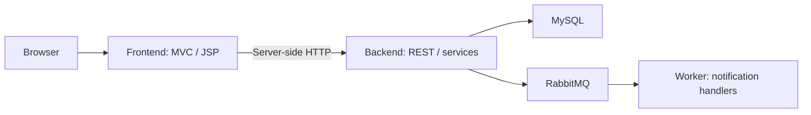

# SupplyChain engineering guideline alignment

## Executive summary

Move all three applications from Java 8 and Spring Boot 2.7.18 to **JDK 21 or 25 and Spring Boot 4.2.x**, as specified by the current guideline; use JDK 21 as the minimum-change common target. The frontend's JSP/WAR deployment needs its own compatibility checks, not just a parent-POM bump.[^platform][^bp][^fp][^wp][^jsp] Add **at least 75% production line coverage from unit tests in each Java project** and a **merge-blocking frontend browser suite**; neither gate was found in the reviewed source trees.[^tests][^ui][^trees] Fix hidden failures and checked-in credentials, and verify the latest guideline's recommendation to use **Azure Application Insights** for all three apps.[^style][^obs][^secret][^workerconfig][^dashboard][^publish] The guideline does not require replacing JSP, RabbitMQ, or `RestTemplate`; changes to those technologies are separate decisions.[^platform][^style][^obs]

## Repositories and integration

| Repository | Scope |
| --- | --- |
| [luxu-ms/SupplyChain-Docs-No-Resarch](https://github.com/luxu-ms/SupplyChain-Docs-No-Resarch) | Authoritative guideline for this assessment.[^platform][^obs] |
| [luxu-ms/SupplyChain-Frontend](https://github.com/luxu-ms/SupplyChain-Frontend) | Server-rendered UI and REST client; browser tests belong here.[^jsp][^client][^ui] |
| [luxu-ms/SupplyChain-Backend](https://github.com/luxu-ms/SupplyChain-Backend) | Orders API, MySQL persistence, and RabbitMQ publisher.[^orders][^secret][^publish] |
| [luxu-ms/SupplyChain-Worker](https://github.com/luxu-ms/SupplyChain-Worker) | RabbitMQ consumers; notifications are currently simulated.[^listener][^workerconfig] |



The diagram shows the checked-in integration, not a required redesign. The frontend sends the order to `POST /api/orders`; the backend saves it and attempts to publish it to RabbitMQ. The worker's handler logs a simulated notification rather than updating the order.[^client][^orders][^publish][^listener]

## Required and recommended changes

### All services: runtime, coding standards, and test gates

- **Runtime:** Set Maven `release` to `21` and align developer, CI, Docker build, and runtime JDKs. Move to Boot 4.2.x; verify dependency resolution, packaging, and startup for each image. Migrate backend JPA and validation imports to Jakarta as needed; verify the frontend WAR, Tomcat, Jasper, and JSTL together. Ensure the image build's `-DskipTests` is not the only build path in CI.[^platform][^bp][^fp][^wp][^images][^jsp][^entity]
- **Coding conventions:** Replace field injection with constructor injection, fix wildcard or unused imports, and enforce consistent formatting. Keep rules in service classes and keep controllers and listeners focused on input, delegation, and response mapping.[^style][^orders][^listener]
- **Unit gate:** Run deterministic JUnit 5 tests with mocked external services. Configure JaCoCo or equivalent to fail each project below **75% line coverage of production code from unit tests alone**; fail on missing tests or report data. Publish integration and UI results separately. Add focused regression tests for changed behavior instead of excluding business logic to meet the gate.[^tests][^trees]

### Backend: validate at the API boundary and distinguish failure from success

Order creation currently binds the persistence entity directly, including writable status and approval fields. The service compares a monetary amount via `doubleValue()`. Use a validated input DTO containing only client-owned fields; validate required values, lengths, IDs, and decimal precision, explicitly establish server-owned initial state, and map invalid input, missing records, and conflicting order state to distinct API errors. For the amount check, the current expression and proposed replacement are:[^style][^orders][^entity][^amount][^approve]

```java
// Existing expression
order.getTotalAmount().doubleValue() <= 0

// Proposed after required-field validation
totalAmount.signum() <= 0
```

Use explicit rounding rules for actual calculations. Move datasource and broker credentials to approved secret storage; assess exposure and rotate any credentials that were in use. Externalize the vendor-rating endpoint and distinguish a valid zero rating from a missing or failed upstream response.[^style][^secret][^rating]

The code currently catches publication exceptions and still returns the saved order. Make the API's success semantics explicit: if success means the order was accepted, surface notification failures through a recoverable mechanism rather than pretending delivery happened. If reliable publication is a business requirement, consider a transactional outbox and confirm delivery behavior separately. The guideline requires truthful failure handling, not a specific messaging pattern.[^style][^publish]

### Frontend: make failures visible and cover the actual workflows

Show **unavailable** rather than resetting dashboard metrics to zero on an upstream failure. Validate submitted form data on the server, preserve permitted values on failure, and show safe field or page errors rather than raw exception text. Fetch active vendors from the backend instead of embedding fixed IDs. The pending page displays an Approve link without a matching MVC handler; remove it until supported, or use a deliberate state-changing form that calls the backend's existing `PUT /api/orders/{orderNumber}/approve` operation.[^style][^dashboard][^form][^newjsp][^vendorclient][^pending][^approve]

Require a Playwright or Selenium PR check for dashboard loading, valid order submission and visibility in the pending list, validation feedback, and inventory browsing. Include upstream failure states and add approval tests when the UI is wired. Use isolated, stateful backend fixtures, stable selectors, condition-based waits, and failure traces or screenshots. The REST calls originate inside the frontend server, so browser-only interception cannot substitute for the backend fixture.[^ui][^client][^inventory]

### Worker and observability: handle messages without hiding failure

Validate the inbound event, delegate processing to a service, and log safe event identifiers rather than complete payloads. Label simulated sends accurately; if delivering real notifications is in scope, verify the provider's result and surface processing failure to the configured message-handling policy. Test backend-to-worker serialization: the backend applies a JSON converter and the listeners accept strings. Typed event contracts, bounded retries, dead-letter handling, and idempotency are options based on the agreed delivery guarantees, not mandates in the guideline.[^style][^listener][^converter]

The guideline says all apps **should** use Azure Application Insights. No checked-in setup was found in the three snapshots; deployment-level instrumentation may already exist. Verify it before adding another agent. Confirm safe request/dependency signals and worker exceptions reach the approved destination; exclude secrets, personal data, and full payloads. Monitoring makes failures visible but does not guarantee message delivery.[^obs][^style][^trees][^images][^listener][^publish]

## Suggested rollout and acceptance

1. **Contain credential exposure and capture current behavior.** Remove hardcoded values, rotate in-use credentials as appropriate, and write focused regression tests for money, invalid vendors, approval transitions, and upstream failures.[^style][^tests][^secret][^workerconfig][^amount][^approve]
2. **Upgrade the platform and remove hidden failures.** Build and start all three images on JDK 21/Boot 4.2.x; verify the frontend renders JSP pages, the backend connects to MySQL, and a test order's JSON reaches the worker. Exercise the failure paths separately.[^platform][^images][^jsp][^secret][^converter][^listener]
3. **Enforce checks and verify monitoring.** Require the per-project unit coverage check and the frontend browser check before merge, and verify Application Insights signals from each actual deployment.[^tests][^ui][^obs]

## Confidence assessment

**High** for guideline wording and checked-in implementation evidence at the pinned commits. **Not verified:** runtime and dependency compatibility, externally configured CI or branch protection, deployed monitoring, and actual broker delivery behavior. This is a static assessment; design choices and proposed acceptance checks are not observed results.[^platform][^trees][^images][^obs][^converter][^listener]

[^platform]: [guideline.md:5–8](https://github.com/luxu-ms/SupplyChain-Docs-No-Resarch/blob/d0ff2f183d555bbaf0dcd105bef83a30f622adb5/guideline.md#L5-L8).
[^style]: [guideline.md:10–19](https://github.com/luxu-ms/SupplyChain-Docs-No-Resarch/blob/d0ff2f183d555bbaf0dcd105bef83a30f622adb5/guideline.md#L10-L19).
[^tests]: [guideline.md:21–25](https://github.com/luxu-ms/SupplyChain-Docs-No-Resarch/blob/d0ff2f183d555bbaf0dcd105bef83a30f622adb5/guideline.md#L21-L25).
[^ui]: [guideline.md:27–31](https://github.com/luxu-ms/SupplyChain-Docs-No-Resarch/blob/d0ff2f183d555bbaf0dcd105bef83a30f622adb5/guideline.md#L27-L31).
[^obs]: [guideline.md:33–35](https://github.com/luxu-ms/SupplyChain-Docs-No-Resarch/blob/d0ff2f183d555bbaf0dcd105bef83a30f622adb5/guideline.md#L33-L35).
[^bp]: [Backend pom.xml:16–27](https://github.com/luxu-ms/SupplyChain-Backend/blob/a21f57e84901bad3cf315de2a3520fa8fe34b911/pom.xml#L16-L27).
[^fp]: [Frontend pom.xml:16–27](https://github.com/luxu-ms/SupplyChain-Frontend/blob/c613adbc961e0499d8f2ddb3e087ade7a9a40881/pom.xml#L16-L27).
[^wp]: [Worker pom.xml:16–27](https://github.com/luxu-ms/SupplyChain-Worker/blob/458f2bab94b08b3acd167feb04fc485a7ecf6133/pom.xml#L16-L27).
[^images]: [Backend Dockerfile:6–24](https://github.com/luxu-ms/SupplyChain-Backend/blob/a21f57e84901bad3cf315de2a3520fa8fe34b911/Dockerfile#L6-L24); [Frontend Dockerfile:2–22](https://github.com/luxu-ms/SupplyChain-Frontend/blob/c613adbc961e0499d8f2ddb3e087ade7a9a40881/Dockerfile#L2-L22); [Worker Dockerfile:2–18](https://github.com/luxu-ms/SupplyChain-Worker/blob/458f2bab94b08b3acd167feb04fc485a7ecf6133/Dockerfile#L2-L18).
[^jsp]: [Frontend pom.xml:37–55](https://github.com/luxu-ms/SupplyChain-Frontend/blob/c613adbc961e0499d8f2ddb3e087ade7a9a40881/pom.xml#L37-L55); [src/main/webapp/WEB-INF/jsp/orders/new.jsp:1–2](https://github.com/luxu-ms/SupplyChain-Frontend/blob/c613adbc961e0499d8f2ddb3e087ade7a9a40881/src/main/webapp/WEB-INF/jsp/orders/new.jsp#L1-L2).
[^trees]: Complete pinned trees: [Backend](https://github.com/luxu-ms/SupplyChain-Backend/tree/a21f57e84901bad3cf315de2a3520fa8fe34b911), [Frontend](https://github.com/luxu-ms/SupplyChain-Frontend/tree/c613adbc961e0499d8f2ddb3e087ade7a9a40881), [Worker](https://github.com/luxu-ms/SupplyChain-Worker/tree/458f2bab94b08b3acd167feb04fc485a7ecf6133). Test/build configuration: [Backend pom.xml:69–92](https://github.com/luxu-ms/SupplyChain-Backend/blob/a21f57e84901bad3cf315de2a3520fa8fe34b911/pom.xml#L69-L92), [Frontend pom.xml:64–87](https://github.com/luxu-ms/SupplyChain-Frontend/blob/c613adbc961e0499d8f2ddb3e087ade7a9a40881/pom.xml#L64-L87), [Worker pom.xml:50–65](https://github.com/luxu-ms/SupplyChain-Worker/blob/458f2bab94b08b3acd167feb04fc485a7ecf6133/pom.xml#L50-L65).
[^client]: [src/main/java/com/acme/scm/frontend/service/BackendApiService.java:23–66](https://github.com/luxu-ms/SupplyChain-Frontend/blob/c613adbc961e0499d8f2ddb3e087ade7a9a40881/src/main/java/com/acme/scm/frontend/service/BackendApiService.java#L23-L66).
[^orders]: [src/main/java/com/acme/scm/controller/PurchaseOrderController.java:6–47](https://github.com/luxu-ms/SupplyChain-Backend/blob/a21f57e84901bad3cf315de2a3520fa8fe34b911/src/main/java/com/acme/scm/controller/PurchaseOrderController.java#L6-L47).
[^entity]: [src/main/java/com/acme/scm/model/PurchaseOrder.java:3–62](https://github.com/luxu-ms/SupplyChain-Backend/blob/a21f57e84901bad3cf315de2a3520fa8fe34b911/src/main/java/com/acme/scm/model/PurchaseOrder.java#L3-L62).
[^amount]: [src/main/java/com/acme/scm/service/PurchaseOrderService.java:36–48](https://github.com/luxu-ms/SupplyChain-Backend/blob/a21f57e84901bad3cf315de2a3520fa8fe34b911/src/main/java/com/acme/scm/service/PurchaseOrderService.java#L36-L48).
[^publish]: [src/main/java/com/acme/scm/service/PurchaseOrderService.java:50–61](https://github.com/luxu-ms/SupplyChain-Backend/blob/a21f57e84901bad3cf315de2a3520fa8fe34b911/src/main/java/com/acme/scm/service/PurchaseOrderService.java#L50-L61).
[^secret]: Backend `src/main/resources/application.yml:8–13,25–31`. Credential-bearing lines intentionally not linked.
[^workerconfig]: Worker `src/main/resources/application.yml:8–13`; queue names at [src/main/resources/application.yml:15–21](https://github.com/luxu-ms/SupplyChain-Worker/blob/458f2bab94b08b3acd167feb04fc485a7ecf6133/src/main/resources/application.yml#L15-L21).
[^rating]: [src/main/java/com/acme/scm/service/VendorService.java:46–58](https://github.com/luxu-ms/SupplyChain-Backend/blob/a21f57e84901bad3cf315de2a3520fa8fe34b911/src/main/java/com/acme/scm/service/VendorService.java#L46-L58).
[^approve]: [src/main/java/com/acme/scm/controller/PurchaseOrderController.java:50–56](https://github.com/luxu-ms/SupplyChain-Backend/blob/a21f57e84901bad3cf315de2a3520fa8fe34b911/src/main/java/com/acme/scm/controller/PurchaseOrderController.java#L50-L56); [src/main/java/com/acme/scm/service/PurchaseOrderService.java:68–90](https://github.com/luxu-ms/SupplyChain-Backend/blob/a21f57e84901bad3cf315de2a3520fa8fe34b911/src/main/java/com/acme/scm/service/PurchaseOrderService.java#L68-L90).
[^dashboard]: [src/main/java/com/acme/scm/frontend/controller/HomeController.java:34–59](https://github.com/luxu-ms/SupplyChain-Frontend/blob/c613adbc961e0499d8f2ddb3e087ade7a9a40881/src/main/java/com/acme/scm/frontend/controller/HomeController.java#L34-L59).
[^form]: [src/main/java/com/acme/scm/frontend/controller/OrderController.java:15–72](https://github.com/luxu-ms/SupplyChain-Frontend/blob/c613adbc961e0499d8f2ddb3e087ade7a9a40881/src/main/java/com/acme/scm/frontend/controller/OrderController.java#L15-L72).
[^newjsp]: [src/main/webapp/WEB-INF/jsp/orders/new.jsp:54–88](https://github.com/luxu-ms/SupplyChain-Frontend/blob/c613adbc961e0499d8f2ddb3e087ade7a9a40881/src/main/webapp/WEB-INF/jsp/orders/new.jsp#L54-L88).
[^vendorclient]: [src/main/java/com/acme/scm/frontend/service/VendorApiService.java:23–33](https://github.com/luxu-ms/SupplyChain-Frontend/blob/c613adbc961e0499d8f2ddb3e087ade7a9a40881/src/main/java/com/acme/scm/frontend/service/VendorApiService.java#L23-L33).
[^pending]: [src/main/webapp/WEB-INF/jsp/orders/pending.jsp:75–83](https://github.com/luxu-ms/SupplyChain-Frontend/blob/c613adbc961e0499d8f2ddb3e087ade7a9a40881/src/main/webapp/WEB-INF/jsp/orders/pending.jsp#L75-L83).
[^inventory]: [src/main/java/com/acme/scm/frontend/controller/InventoryController.java:23–28](https://github.com/luxu-ms/SupplyChain-Frontend/blob/c613adbc961e0499d8f2ddb3e087ade7a9a40881/src/main/java/com/acme/scm/frontend/controller/InventoryController.java#L23-L28).
[^listener]: [src/main/java/com/acme/scm/worker/listener/OrderMessageListener.java:16–56](https://github.com/luxu-ms/SupplyChain-Worker/blob/458f2bab94b08b3acd167feb04fc485a7ecf6133/src/main/java/com/acme/scm/worker/listener/OrderMessageListener.java#L16-L56).
[^converter]: [src/main/java/com/acme/scm/config/AppConfig.java:58–67](https://github.com/luxu-ms/SupplyChain-Backend/blob/a21f57e84901bad3cf315de2a3520fa8fe34b911/src/main/java/com/acme/scm/config/AppConfig.java#L58-L67).
